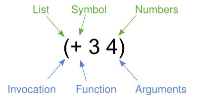

class: center, middle

## Conceptes Avançats de Programació

# Introducció a Clojure

<br>

**Jordi Delgado i Gerard Escudero**

<br>

Departament de Ciències de la Computació

Universitat Politècnica de Catalunya

<br>

 

---
class: left, middle, inverse

## Contingut

- .cyan[L'eina]

- Tipus bàsics, expressions i llistes

- Funcions, definicions locals, condicionals i destructuring

- Recursivitat

- Tractament d'excepcions

- Exercicis

---

# Clojure

Dialecte de LISP que compila a la JVM.

### Referències

- Plana principal: [https://clojure.org/](https://clojure.org/)

- Instal·lació: [https://clojure.org/guides/install_clojure](https://clojure.org/guides/install_clojure)

### Eina:

.cols5050[
.col1[

```clojure
clj
```

És un *REPL* (intèrpret) i compilador.
]
.col2[
- quit: *Ctrl + d*

- load: `(load-file "nom.clj")`
]]

---

# Amb projecte

**Estructura del projecte**:

```
deps.edn
src/
└── hola_mon.clj
```

```clojure
;; deps.edn
{:paths ["src"]}
```

```clojure
;; hola_mon.clj
(ns hola_mon)
(println "Hola, món!")
```

**Execució**:

```shell
gerard@lopetit:~/docencia/cap/hola_mon$ clj
Clojure 1.11.3
(use 'hola_mon :reload-all)
Hola món!
nil
user=> 
```

---

# Línia de comandes

**Expressions**:

```shell
gerard@lopetit:~/docencia/cap/hola_mon$ clj -M -e '(+ 1 2)'
3
gerard@lopetit:~/docencia/cap/hola_mon$
```

**Scripts**:

```shell
gerard@lopetit:~/docencia/cap/hola_mon$ clj -M -e "(use 'hola_mon)"
Hola món!
gerard@lopetit:~/docencia/cap/hola_mon$
```

---

# Creació d'un arxiu *jar*

**deps.edn**:

```clojure
{
  :paths ["src"]
  :deps {clojure.java-time/clojure.java-time {:mvn/version "1.1.0"}}
  :main-opts ["-m" "core"]
  :aliases {
    ;; build an uberjar (application) with AOT compilation by default:
    :uberjar {:replace-deps {com.github.seancorfield/depstar {:mvn/version "2.1.303"}}
             :exec-fn hf.depstar/uberjar
             :exec-args {:aot true}}
    ;; build a jar (library):
    :jar {:replace-deps {com.github.seancorfield/depstar {:mvn/version "2.1.303"}}
          :exec-fn hf.depstar/jar
          :exec-args {}}
   }
}
```
.cols5050[
.col1[
**hola_mon.clj**:

```clojure
(ns hola_mon)
(defn -main []
  (println "Hola món!"))
```
]
.col2[
**ordres**:
```shell
clj -X:uberjar :jar hola_mon.jar
java -cp hola_mon.jar clojure.main 
     -m hola_mon 
```
]]

---
class: left, middle, inverse

## Contingut

- .brown[L'eina]

- .cyan[Tipus bàsics, expressions i llistes]

- Funcions, definicions locals, condicionals i destructuring

- Recursivitat

- Tractament d'excepcions

- Exercicis

---

# Tipus bàsics

.cols5050[
.col1[
**Nombres**:

- Enters (64bits): `-5`

- Enters (sense rang): `64N`

- Racionals: `22/7`

- Reals (double): `3.1416`

- Reals (precisió arbitrària): `0.01M`

**Booleans**:

- `true` i `false`

**Caràcters**:

- `\c`, `\newline`
]
.col2[


**Strings**:

- `"Hola món!"`

**Keywords**:

- `:nom`

**Expressions regulars**:

- `#"[0-9]+"`

**Símbols**:

- `x`, `+`, `max`

- funcions
]]

---

# Expressions aritmètiques

Sempre van amb parèntesis amb notació prefixa:

```clojure
(+ 1 3)  👉  4 
```

La majoria d'operadors són n-àris:

```clojure
(+ 1 2 3 4)  👉  10
```

```clojure
(/ 64 2 2 2)  👉  8
```

No hi ha precedència d'operadors en Clojure; no calen degut a la notació.

.cols5050[
.col1[
**Operadors no usuals**:

- divisió: `quot`, `rem`, `mod`

- altres: `inc`, `dec`, `max`, `min`

- nombres grans: `+'`, `*'`...
]
.col2[
**Predicats**:

- `zero?`, `pos?`, `neg?`

- `even?`, `odd?`

- `int?`, `rational?`, `float?`...
]]

---

# Expressions booleanes

**Operadors relacionals**:

- ⚠️ `=`, ⚠️ `not=`, `<`...

**Operadors lògics**:

- `and`, `or`, `not`

**Nota**:

- `nil` equival a `false`.

.cols5050[
.col1[
## Càsting

```clojure
(/ 5 2)  👉  5/2
```

```clojure
(float (/ 5 2))  👉  2.5
```
]
.col2[
## Símbols

```clojure
(def x 2)

(inc x)  👉  3
```
]]

---

# Llistes

**Sintaxi i semàntica**:

|  |
|:---:|
| font: [Learn Clojure - Syntax](https://clojure.org/guides/learn/syntax) |

**Quoting (endarrerir computació)**:

```clojure
(1 2 3)  👉  Execution error

'(1 2 3)  👉  (1 2 3)

(quote (1 2 3))  👉  (1 2 3)
```

---

# Més llistes

| element | descripció | exemple |
|:---|:---|:---|
| `'()` | llista buida | `'()  👉  ()` |
| `empty?` | predicat llista buida? | `(empty? '())  👉  true`|
| `first` | primer element | `(first '(1 2 3))  👉  1` |
| `rest` | resta d'elements | `(rest '(1 2 3))  👉  (2 3)` |
| `conj` | afegir un element | `(conj '(1 2 3) 0)  👉  (0 1 2 3)` |
| `apply` | aplicar funció a llista | `(apply + '(1 2 3))  👉  6` |
| `concat` | concatenar llistes | `(concat '(1 2) '() '(3))  👉  (1 2 3)` |
| `range` | generador de llistes | `(range 5)  👉  (0 1 2 3 4)` |
| | | `(range 1 5)  👉  (1 2 3 4)` |
| `take`| subllista esquerra | (take 3 (range 6))  👉  (0 1 2) |
| `drop`| subllista dreta | (drop 3 (range 6))  👉  (3 4 5) |

**Vectors**:

- Estructura similar a les llistes: `[1 2 3]`

- Els paràmetres de les funcions venen en vectors.

---
class: left, middle, inverse

## Contingut

- .brown[L'eina]

- .brown[Tipus bàsics, expressions i llistes]

- .cyan[Funcions, definicions locals, condicionals i destructuring]

- Recursivitat

- Tractament d'excepcions

- Exercicis

---

# Funcions

```clojure
;;    nom    params         cos
;;    -----  ------  ---------------------
(defn hola   [nom]   (str "Hola " nom "!") )
```

```clojure
(hola "Gerard")  👉  "Hola Gerard!"
```
.cols5050[
.col1[
**Anònimes**:

```clojure
(#(+ 2 %) 3)  👉  5
```

```clojure
(#(+ 1 %1 %2) 3 4)  👉  8
```

```clojure
((fn [x y] (+ 1 x y)) 3 4)  👉  8
```
]
.col2[
**Equivalència**:

```clojure
(def suma2 #(+ 2 %))
```

```clojure
(defn suma2 [x] 
  (+ 2 x))
```
]]

.footnote[[Documentació sobre funcions (més opcions)](https://clojure.org/guides/learn/functions)]

---

# Definicions locals

El `let` serveix per crear un lligam (*binding*) en un context (*scope*) lèxic.

**Sintaxi**:

```clojure
;;      bindings     lexical scope
;;    ------------  ------------------
(let  [nom valor]   (codi que usa nom) )
```

**Exemple**:

```clojure
(let [x 1
      y 2]
  (+ x x y 1))

👉  5
```

---

# Condicionals

**Simple**:

```clojure
(let [x 4]
  (if (even? x)
    "parell"
    "senar"))

👉  "parell"
```

**Múltiple**:

```clojure
(defn signe [x]
  (cond 
    (< x 0) -1
    (> x 0) 1
    :else 0))
```

```clojure
(signe -3)  👉  -1
```

---

# Destructuring

És una forma de crear *bindings* a valors a partir d'estructures.

**Sequential destructuring**:

```clojure
(defn preu [v]
    (let [[quantitat preu-unitari] v]
        (* quantitat preu-unitari)))

(preu '(2 3.50))  👉  7.0
```

**Sequential amb cua**:

```clojure
(let [[x y & z] (range 5)]
    (list (list x y) z))  👉  ((0 1) (2 3 4))
```

---
class: left, middle, inverse

## Contingut

- .brown[L'eina]

- .brown[Tipus bàsics, expressions i llistes]

- .brown[Funcions, definicions locals, condicionals i destructuring]

- .cyan[Recursivitat]

- Tractament d'excepcions

- Exercicis

---

# Recursivitat

.cols5050[
.col1[
```clojure
(defn factorial [n]
  (if (< n 2) 
    n
    (*' n (factorial (dec n)))))
```

```clojure
(factorial 4)  👉  24
```

**Nota**:

- La recursivitat amb `recur` no consumeix pila en les crides.

- L'ús de `recur` implica que estigui en *tail position* (el compilador ho comprova).

- La *jvm* no té l'optimització *tail recursion*.
]
.col2[
**Loop + recur**:
 
```clojure
(defn factorial [n]
  (loop [i n 
         acc n]
    (if (= i 1) 
      acc
      (let [d (dec i)]
        (recur d (*' acc d))))))
```

o

```clojure
(defn factorial 
  ([n] (factorial n n))
  ([i acc]
    (if (= i 1) 
      acc
      (let [d (dec i)]
        (recur d (*' acc d))))))
```

]]

---
class: left, middle, inverse

## Contingut

- .brown[L'eina]

- .brown[Tipus bàsics, expressions i llistes]

- .brown[Funcions, definicions locals, condicionals i destructuring]

- .brown[Recursivitat]

- .cyan[Tractament d'excepcions]

- Exercicis

---

# Tractament d'excepcions

**Captura**:

```clojure
(try 
  (/ 2 0) 
  (catch Exception e (.getMessage e)))

👉  "Divide by zero"
```

**Llançament**:

```clojure
(try
  (throw (Exception. "Hola excepció!"))
  (catch Exception e (.getMessage e)))

👉  "Hola excepció!"
```

---
class: left, middle, inverse

## Contingut

- .brown[L'eina]

- .brown[Tipus bàsics, expressions i llistes]

- .brown[Funcions, definicions locals, condicionals i destructuring]

- .brown[Recursivitat]

- .brown[Tractament d'excepcions]

- .cyan[Exercicis]

---

# Exercicis

1. Definiu el símbol `x=2` i avalueu l'expressió aritmètica $1+\frac{1+2x}{3}+x^2$.

2. Definiu el símbol `n=25` i avalueu l'expressió booleana que ens indiqui si `n` és un senar ubicat en un dels intervals $[10,20]$ o $[30,40]$.

3. Doneu una funció en que, donat un natural, en indiqui si és senar o parell.<br> `(f 5)  👉  "senar"`

4. Doneu una funció en que, donada una nota, ens indiqui el seu equivalent textual.<br>  `(f 5.6)  👉  "aprovat"`

5. [U28436 Clojure - Funcions amb nombres](https://jutge.org/problems/U28436_ca)

6. [S96390 Clojure - Funcions amb llistes](https://jutge.org/problems/S96390_ca)

7. [Y75706 Clojure - Funcions amb llistes 2 ](https://jutge.org/problems/Y75706_ca)

